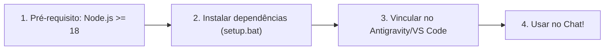

# 🚀 MCP SSH Server (Antigravity / VS Code / Claude)

Servidor MCP (Model Context Protocol) para automação remota via SSH e SFTP com foco em alta segurança, projetado especificamente para agentes de IA (Google Antigravity, VS Code / Cline / Roo, Claude Desktop) gerenciarem e operarem servidores com eficiência.

---

## 🏁 Tutorial Rápido: O que fazer após clonar no Windows? (Passo a Passo)

Se você acabou de clonar este repositório para o seu Windows, siga estes 4 passos simples:



### Passo 1: Verificar se tem o Node.js instalado
Abra o PowerShell ou Prompt de Comando e digite:
```powershell
node -v
```
* Deve exibir `v18.x.x`, `v20.x.x`, `v22.x.x` ou superior.
* Se der comando não encontrado, baixe e instale a versão LTS oficial em: **[https://nodejs.org/](https://nodejs.org/)** *(marque a opção de adicionar ao PATH durante a instalação)*.

---

### Passo 2: Instalar as dependências do projeto

Você tem duas formas simples:

* **Opção A (Automática com 2 cliques):**
  Dê um duplo clique no arquivo **`setup.bat`** na pasta do projeto. Ele verifica o Node, instala tudo automaticamente e roda os testes de segurança para confirmar que está tudo 100%.

* **Opção B (Pelo terminal):**
  Abra o terminal na pasta do projeto e execute:
  ```powershell
  npm install
  npm test
  ```
  *(Os testes devem finalizar com `🎉 TODOS OS 45 TESTES PASSARAM COM SUCESSO!`)*.

---

### Passo 3: Cadastrar o MCP no seu Antigravity, VS Code ou Claude Desktop

Agora informe ao seu aplicativo de IA onde está o servidor MCP.

#### 🔹 No Google Antigravity:
1. Abra as configurações do Antigravity (ou menu MCP).
2. Adicione a configuração:
```json
{
  "mcpServers": {
    "ssh-vault": {
      "command": "node",
      "args": ["C:/caminho/para/mcp-ssh-server-antigravity/src/index.js"]
    }
  }
}
```
*(Substitua `C:/caminho/para/...` pelo caminho real da pasta onde você clonou no seu Windows. Dica: use barras normais `/` ou barras duplas `\\` no JSON).*

#### 🔹 No VS Code (extensões Cline / Roo Code / Roo-Cline):
No arquivo de configuração MCP da extensão (`cline_mcp_settings.json`):
```json
{
  "mcpServers": {
    "ssh-vault": {
      "command": "node",
      "args": ["C:\\caminho\\para\\mcp-ssh-server-antigravity\\src\\index.js"]
    }
  }
}
```

#### 🔹 No Claude Desktop:
No menu `Settings` > `Developer` > `Edit Config` (`claude_desktop_config.json`), adicione o bloco acima.

---

### Passo 4: Pronto! Como usar diretamente no Chat com o Agente

Reinicie o Antigravity / VS Code / Claude. Agora o agente já possui as ferramentas SSH. Veja como conversar com ele:

#### A. Inicializar seu cofre pela primeira vez:
> *"Por favor, inicialize meu cofre SSH com a senha mestra [SuaSenhaSuperSegura123]"*

#### B. Cadastrar seu servidor:
> *"Cadastre meu servidor 'web-prod' no cofre: host 192.168.1.100, porta 22, usuário deploy, senha [SenhaDoSSH]. Minha senha mestra é [SuaSenhaSuperSegura123]"*

#### C. Executar comandos:
> *"Execute `uptime` e `df -h` no servidor 'web-prod'"*

---

## 💡 Dúvidas Frequentes sobre Configurações

### ❓ "Por que não tem o arquivo de servidores (`servers-config.enc.json`) no repositório?"
Por **design de segurança absoluto**:
* O arquivo guardaria seus IPs, usuários, senhas ou chaves SSH privadas.
* Ele é mantido fora do Git (no `.gitignore`) para **proteger suas credenciais**.
* Ao rodar pela primeira vez e chamar `vault_init`, o MCP cria esse arquivo **localmente** no seu disco de forma criptografada em AES-256-GCM.
* Se quiser ver os campos aceitos em cada servidor, consulte o arquivo template [`config.example.json`](config.example.json).

---

## 🛠️ Gerenciando seus Servidores no Dia a Dia

Você **nunca precisa editar nenhum JSON manualmente**. Faça tudo pelo chat:

| Ação | O que pedir no chat | Tool chamada |
| :--- | :--- | :--- |
| **Inicializar cofre** | *"Inicialize meu cofre com a senha mestra X"* | `vault_init` |
| **Adicionar servidor** | *"Adicione o servidor nome, host, user, senha ou chave PEM com a senha mestra X"* | `vault_add_server` |
| **Editar servidor** | *"Atualize o servidor nome: mude a porta para 2222 com a senha mestra X"* *(basta manter o mesmo nome)* | `vault_add_server` |
| **Remover servidor** | *"Remova o servidor nome com a senha mestra X"* | `vault_remove_server` |
| **Consultar lista** | *"Quais servidores tenho cadastrados?"* | `vault_status` |
| **Desbloquear sessão** | *"Desbloqueie o cofre com a senha mestra X"* | `vault_unlock` |

---

## 🔒 Arquitetura de Segurança Implementada

1. **Criptografia Militar (AES-256-GCM + PBKDF2)**:
   * 100.000 iterações de SHA-512 com Salt randômico de 32 bytes e autenticação de integridade por Auth Tag.
   * Chave derivada mantida **estritamente em memória RAM** durante a sessão.
2. **Denylist de Comandos Destrutivos**:
   * O MCP bloqueia automaticamente comandos acidentais ou perigosos do LLM: `rm -rf /`, `mkfs`, `dd of=/dev/`, `reboot`, `shutdown`, fork-bombs.
3. **Bloqueio de Comandos Interativos**:
   * Comandos como `top`, `vim`, `less`, `sudo` interativo são rejeitados de imediato para evitar travamento da sessão.
4. **Proteção Anti-Prompt Injection**:
   * Qualquer saída remota (`stdout`/`stderr`) é encapsulada com avisos de integridade e truncada em 512KB para evitar ataques de injeção e estouro de contexto.
5. **Reuso Eficiente (Connection Pool)**:
   * Sessões SSH são mantidas em cache durante comandos sequenciais com auto-fechamento após 60s de inatividade.

---

## 🧪 Testes Automatizados

O repositório inclui uma bateria de testes completa cobrindo criptografia, comandos SSH, SFTP e todas as barreiras de segurança:
```bash
npm test
```
*(45 testes integrados executados com 100% de sucesso)*.
