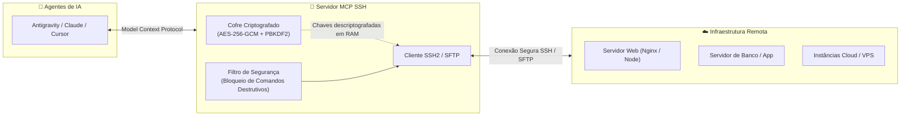

# 🚀 MCP SSH Server (Antigravity / VS Code / Claude)

Servidor MCP (Model Context Protocol) para automação remota via SSH e SFTP com foco em alta segurança, projetado para que o seu agente de IA faça **absolutamente tudo por você** através do chat.

---

## ⚡ Setup em 1 Clique (Zero Configuração Manual)

Você **não precisa instalar nada na mão, não precisa abrir terminal, nem checar versão de Node**.

Depois de clonar ou baixar este repositório, basta abrir o chat com o seu Agente de IA (Antigravity, VS Code, Cursor ou Claude) e colar a seguinte mensagem:

> 💬 **"Analise este projeto, instale tudo o que precisa e configure tudo de forma 100% automática para mim. Deixe o servidor MCP SSH pronto para uso."**

O próprio agente:
1. Verifica se o Node.js está presente na sua máquina.
2. Instala todas as dependências automaticamente (`npm install`).
3. Executa a suíte de testes de segurança para garantir integridade.
4. Te devolve a configuração exata pronta para ativar o MCP no seu app.

---

## 💬 Como Usar pelo Chat (Comandos em Linguagem Natural)

Você **nunca precisa editar nenhum arquivo de código ou JSON**. Tudo é feito conversando com o agente:

### 1️⃣ Inicializar o Cofre (Primeira Vez)
O cofre é criado vazio e protegido com criptografia militar AES-256 no seu próprio computador. Basta pedir:
> 💬 *"Inicialize meu cofre SSH com a senha mestra [SuaSenhaSuperSegura123]"*

---

### 2️⃣ Cadastrar, Editar ou Deletar Servidores
Converse normalmente com o agente para gerenciar seus servidores:

| O que você quer fazer | O que colar no Chat com o Agente |
| :--- | :--- |
| **Cadastrar servidor (com senha)** | *"Adicione o servidor 'web-prod' no IP 192.168.1.50, porta 22, usuário deploy, senha [SenhaDoSSH], descrição 'Servidor Principal'. Minha senha mestra é [SuaSenhaSuperSegura123]"* |
| **Cadastrar com chave privada (.pem)** | *"Adicione o servidor 'db-prod' no IP 10.0.0.10, usuário ubuntu, usando esta chave privada: [Cole o texto da chave PEM]. Senha mestra: [SuaSenhaSuperSegura123]"* |
| **Editar um servidor existente** | *"Atualize o servidor 'web-prod': mude a porta para 2222 e o usuário para admin. Minha senha mestra é [SuaSenhaSuperSegura123]"* *(o agente atualiza automaticamente)* |
| **Excluir um servidor** | *"Remova o servidor 'web-prod' do meu cofre. Senha mestra: [SuaSenhaSuperSegura123]"* |
| **Ver servidores cadastrados** | *"Quais servidores estão cadastrados no meu cofre SSH?"* *(o agente lista com segurança, sem expor suas senhas)* |
| **Desbloquear no início do dia** | *"Desbloqueie meu cofre SSH com a senha [SuaSenhaSuperSegura123]"* |
| **Executar comandos remotos** | *"Execute `uptime` e `docker ps` no servidor 'web-prod'"* |

---

## 💡 Dica de Ouro: Potencialize o MCP SSH com as Skills do Antigravity!

Se você utiliza o **Google Antigravity**, você pode elevar o poder deste servidor MCP combinando-o com as **Skills Operacionais**.

Quando você ensina rotinas específicas para o agente através de arquivos `SKILL.md`, ele passa a executar comandos SSH de forma muito mais inteligente, segura e contextual, sabendo exatamente o que fazer sem que você precise ditar comando por comando.

### 🌟 Exemplos de Skills Prontas para o Dia a Dia:

1. **`ssh-safety-guard` (Segurança, Backups & Rollback Automático)**:
   * Antes de alterar qualquer arquivo de configuração remoto, o agente automaticamente cria uma cópia de backup com data/hora (`arquivo.conf.bak_YYYYMMDD_HHMMSS`).
   * Já deixa pronto o plano de reversão imediata (rollback) caso o serviço falhe após a alteração.
   * Evita toques acidentais em caminhos críticos como `/etc/shadow`, `/boot/`, ou dados de banco sem dump.

2. **`nginx-ops` (Diagnóstico e Operação Nginx)**:
   * Identifica na hora a causa de erros `502 Bad Gateway` checando portas upstream (`Node`, `Java`, `PHP`, `Python`).
   * Faz análise direcionada dos últimos erros críticos nos logs (`/var/log/nginx/error.log`).
   * **Nunca reinicia o Nginx** sem rodar previamente o comando `nginx -t` para validar a sintaxe dos arquivos.

3. **`jboss-wildfly-ops` (Diagnóstico Java & Deploys)**:
   * Gerencia deploys `.war` / `.ear` monitorando os gatilhos `.dodeploy`, `.deployed` e inspecionando o stacktrace em `.failed`.
   * Vasculha logs da JVM atrás de gargalos comuns como `OutOfMemoryError` ou pools de conexão de banco esgotados.

### 🚀 Como ativar essas Skills no seu Antigravity?
Basta colar a seguinte mensagem no chat com o seu Antigravity:

> 💬 *"Com base no arquivo `LEMBRETE_SKILLS_CORPORATIVO.md` deste repositório, configure para mim as skills operacionais `ssh-safety-guard`, `nginx-ops` e `jboss-wildfly-ops` na minha pasta global de skills do Antigravity."*

O Antigravity salvará as skills na sua pasta global e, a partir desse momento, **toda intervenção remota via MCP SSH seguirá automaticamente essas boas práticas de DevOps e produção!**

---

## 🔒 Arquitetura de Segurança Transparente

* **Privacidade Absoluta**: Nenhuma senha, IP ou credencial sua é versionada no Git.
* **Criptografia Forte**: Dados protegidos com AES-256-GCM + PBKDF2 (100.000 iterações SHA-512). A chave descriptografada permanece apenas na memória RAM enquanto a sessão estiver aberta.
* **Trava contra Desastres**: Comandos destrutivos acidentais como `rm -rf /`, `mkfs`, `dd of=/dev/`, `reboot` e `shutdown` são bloqueados na raiz pelo MCP.
* **Sem Travamentos**: Comandos interativos (`top`, `vim`, `less`, `sudo` com prompt) são interceptados com orientações não-interativas.
* **Proteção contra Prompt Injection**: Saídas de servidores remotos são encapsuladas e truncadas em 512KB para proteger o contexto do LLM.

---

## 👤 Autor

Desenvolvido por **[Igor Paiva](https://github.com/igorpaiva26)**.  
*Servidor MCP de infraestrutura e automação remota segura projetado para agentes de Inteligência Artificial.*

